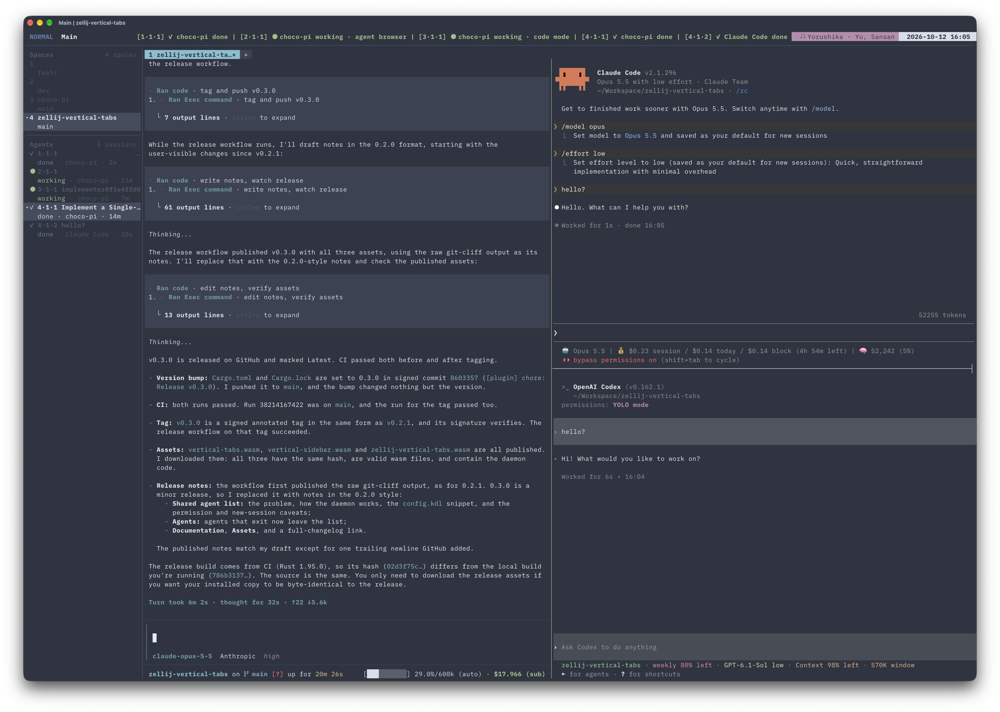

# zellij-vertical-tabs

[English](README.md) | 한국어

가로 상태 표시줄, 세로 사이드바, 한 줄짜리 탭 바를 제공하는 Zellij WebAssembly 플러그인입니다. 탭(스페이스로 묶을 수 있음), 저장소, 브랜치, 연결된 워크트리 상태, 시계나 Apple Music에서 재생 중인 곡, choco-pi, Claude Code, Codex 및 터미널에서 감지한 코딩 에이전트의 상태를 표시합니다. 네 번째 뷰는 백그라운드에서 세션 전체의 에이전트 목록을 하나로 관리합니다.



## 설치

두 릴리스 파일을 다운로드합니다. 두 파일은 같은 플러그인 바이너리지만, Zellij가 URL을
기준으로 플러그인 인스턴스를 구분할 수 있도록 서로 다른 이름을 사용합니다.

```sh
mkdir -p ~/.config/zellij/plugins
curl -fL https://github.com/Nebu1eto/zellij-vertical-tabs/releases/latest/download/vertical-tabs.wasm \
  -o ~/.config/zellij/plugins/vertical-tabs.wasm
curl -fL https://github.com/Nebu1eto/zellij-vertical-tabs/releases/latest/download/vertical-sidebar.wasm \
  -o ~/.config/zellij/plugins/vertical-sidebar.wasm
```

처음 실행할 때 각 플러그인 창에 포커스를 두고 `y`를 눌러 요청된 권한을 허용합니다. 그다음 [에이전트 상태 공유](#에이전트-상태-공유)의 백그라운드 데몬을 추가하고 새 세션을 시작하세요.

## 설정

다음 레이아웃은 서로 다른 경로에서 가로 보기와 세로 보기를 불러옵니다. 정확한 열 너비를 유지하면서 크기를 조절할 수 있도록 사이드바 pane의 size는 지정하지 않습니다.

```kdl
layout {
    pane size=2 borderless=true {
        plugin location="file:~/.config/zellij/plugins/vertical-tabs.wasm" {
            view "horizontal"
            show_tabs "true"
            timezone_offset_hours "9"
        }
    }
    pane split_direction="vertical" {
        pane
        pane borderless=true {
            plugin location="file:~/.config/zellij/plugins/vertical-sidebar.wasm" {
                view "vertical"
                initial_width "28"
                home "/Users/example"
                vertical_separator_enabled "true"
                vertical_separator_char "│"
            }
        }
    }
}
```

주요 설정 키는 다음과 같습니다.

| 키 | 값 또는 용도 |
| --- | --- |
| `view` | `"horizontal"`, `"vertical"`, `"tabs"`, `"daemon"` 중 하나([에이전트 상태 공유](#에이전트-상태-공유) 참고) |
| `show_tabs` | 가로 탭 표시 여부. 기본값은 `"true"` |
| `timezone_offset_hours` | UTC 기준 시계 오프셋(시간) |
| `home` | 작업 디렉터리를 표시할 때 사용할 홈 경로 |
| `initial_width` | 세로 사이드바의 초기 열 너비. 크기 조절을 유지하려면 레이아웃 pane의 size를 지정하지 않음 |
| `vertical_separator_enabled` | 사이드바 구분선 표시 여부. 기본값은 `"true"` |
| `vertical_separator_char` | 사이드바 구분선 문자. 기본값은 `"│"` |
| `border_enabled` | 사이드바 구분선과 별개인 가로 보기 테두리 사용 여부 |
| `border_char` | 가로 보기 테두리 문자 |
| `right_panel` | 가로 막대 오른쪽 끝: `"clock"`(기본값), `"music"`, `"both"`. music 옵션은 macOS 전용이며 다른 OS에서는 시계로 대체 |
| `music_format` | 재생 중 텍스트. 자리표시자 `{music}`(또는 `{title}`), `{artist}`, `{album}`, `{albumart}`. 기본값은 `"{artist} - {music}"` |
| `music_max_width` | 재생 중 텍스트의 최대 열 너비. 초과하면 `…`로 자름. 기본값은 `"40"` |
| `center_anchor` | 가로 막대 가운데의 탭·컨텍스트·에이전트 상태를 맞추는 기준. `"bar"`(기본값)는 막대 중앙, `"content"`는 활성 탭에서 세로 사이드바를 제외한 pane 영역의 중앙. 어느 쪽이든 좌우 구간과 겹치면 옆으로 밀림 |

### 재생 중 표시

`right_panel "music"` 또는 `"both"`를 지정하면 Apple Music이 재생 중이거나 일시정지한 트랙을 막대에 표시합니다. Music의 AirPlay 선택 창에서 **컴퓨터** 항목의 스피커로 재생하는 경우도 포함됩니다. **홈** 항목에서 HomePod이나 Apple TV를 선택하면 해당 기기가 직접 Apple Music을 재생하고 Music은 리모컨 역할만 하므로, macOS가 Mac의 플레이어를 보고하지 않아 표시가 비어 있습니다. Music이 정지되어 있거나 실행 중이 아닐 때도 표시하지 않으며, 플러그인이 Music을 실행하지는 않습니다. Zellij가 호스트에서 `osascript`로 Music에 접근하므로 macOS가 Zellij 서버에 대한 자동화 권한을 한 번 묻습니다. 거부하면 표시가 비어 있습니다. 폴링 주기는 트랙에 맞춰 조정됩니다. 재생 중에는 남은 시간의 절반(3–20초), 그 외에는 10초입니다.

`{albumart}`는 현재 `♪`로 표시됩니다. Zellij 0.45는 플러그인 pane의 kitty 그래픽 프로토콜을 버리고 Ghostty는 sixel을 지원하지 않아 아직 앨범 아트를 그릴 방법이 없습니다.

색상에는 `#RRGGBB` 또는 `RRGGBB` 형식을 사용합니다. 값이 올바르지 않으면 내장 Nord 기본값을 사용합니다. 다음 키를 설정할 수 있습니다.

```text
color_background
color_session_fg  color_session_bg
color_mode_normal_fg  color_mode_normal_bg
color_mode_locked_fg  color_mode_locked_bg
color_mode_resize_fg  color_mode_resize_bg
color_mode_pane_fg  color_mode_pane_bg
color_mode_tab_fg  color_mode_tab_bg
color_mode_search_fg  color_mode_search_bg
color_mode_rename_tab_fg  color_mode_rename_tab_bg
color_mode_rename_pane_fg  color_mode_rename_pane_bg
color_mode_move_fg  color_mode_move_bg
color_mode_default_fg  color_mode_default_bg
color_tab_normal_fg  color_tab_normal_bg
color_tab_active_fg  color_tab_active_bg
color_cwd_normal_fg  color_cwd_normal_bg
color_cwd_active_fg  color_cwd_active_bg
color_context_fg  color_context_bg
color_clock_fg  color_clock_bg
color_music_fg  color_music_bg
color_border_fg  color_border_bg
color_agent_fg  color_agent_bg
color_agent_urgent_fg  color_agent_urgent_bg
```

## 스페이스

스페이스는 이름 접두사를 공유하는 탭 묶음입니다. 예를 들어 `work/api`와 `work/web`은 모두 `work` 스페이스에 속합니다. 사이드바는 스페이스 목록을 보여 주고, 가로 막대는 활성 스페이스의 탭만 보여 주며, pane은 평소의 Zellij 분할 그대로입니다. 탭 이름을 바꾸면 그 탭이 다른 스페이스로 옮겨집니다.

이 기능은 기본적으로 꺼져 있습니다. 두 보기 모두에서 켜 주세요.

```kdl
plugin location="file:~/.config/zellij/plugins/vertical-sidebar.wasm" {
    view "vertical"
    spaces "true"
}
```

플러그인은 자기 pane이 포커스를 가진 동안에만 키를 받기 때문에, 스페이스 조작은 키바인드로 전달합니다. `config.kdl`에 아래를 추가하고, 같은 키에 걸려 있던 `GoToTab` 바인딩은 제거하세요. 그 동작은 전역 탭 번호를 가리키므로 스페이스를 가로질러 이동합니다.

```kdl
keybinds {
    normal {
        bind "Super n" { MessagePlugin { name "vtabs:space-new"; }; }
        bind "Super t" { MessagePlugin { name "vtabs:tab-new"; }; }
        bind "Super 1" { MessagePlugin { name "vtabs:space-switch"; payload "1"; }; }
        bind "Super 2" { MessagePlugin { name "vtabs:space-switch"; payload "2"; }; }
        bind "Super Alt Right" { MessagePlugin { name "vtabs:tab-next"; }; }
        bind "Alt 1" { MessagePlugin { name "vtabs:tab-switch"; payload "1"; }; }
        bind "Super Alt Left" { MessagePlugin { name "vtabs:tab-prev"; }; }
    }
}
```

`MessagePlugin`에는 플러그인 URL을 적지 않습니다. URL을 적으면 Zellij가 위치와 설정을 함께 비교해 실행 중인 인스턴스를 찾기 때문에, 레이아웃의 모든 설정 키를 그대로 반복하지 않은 바인딩은 사이드바에 닿지 못하고 플러그인 pane을 새로 엽니다.

| 명령 | 동작 |
| --- | --- |
| `vtabs:space-new` | 첫 탭과 함께 새 스페이스 생성 |
| `vtabs:tab-new` | 활성 스페이스에 새 탭 생성 |
| `vtabs:space-switch` | `payload` 번째 스페이스로, 마지막에 머문 탭으로 이동 |
| `vtabs:tab-switch` | 활성 스페이스 안에서 `payload` 번째 탭으로 이동 |
| `vtabs:tab-next`, `vtabs:tab-prev` | 활성 스페이스 안에서 탭 순환 |

`spaces`가 꺼져 있으면 같은 바인딩이 본래 Zellij 동작대로 새 탭, 번호로 탭 이동, 다음/이전 탭으로 작동합니다.

| 키 | 값 또는 용도 |
| --- | --- |
| `spaces` | 탭을 스페이스로 묶기, 기본값 `"false"` |
| `space_separator` | 스페이스와 탭 이름 구분자, 기본값 `"/"` |
| `default_space_name` | 구분자가 없는 탭이 속할 스페이스, 기본값 `"main"` |
| `auto_tab_names` | 자동 생성된 탭을 저장소나 디렉터리 이름으로 표시, 기본값 `"true"` |
| `auto_space_names` | 자동 생성된 스페이스를 프로젝트 이름으로 표시, 기본값 `"true"` |

### 탭 바

스페이스를 켤 때는 탭 줄을 스페이스 내용 위의 한 줄짜리 pane으로 분리하세요. 상태 표시줄 가운데가 에이전트와 음악용으로 남습니다.

```kdl
pane split_direction="horizontal" {
    pane size=1 borderless=true {
        plugin location="file:~/.config/zellij/plugins/vertical-tabs.wasm" {
            view "tabs"
            spaces "true"
        }
    }
    children
}
```

이 줄은 활성 스페이스의 탭을 왼쪽부터 나열하고 마지막 탭 바로 뒤에 `+` 버튼을 둡니다. 탭을 누르면 이동하고 `+`를 누르면 스페이스에 탭이 추가됩니다. 각 탭의 `×` 버튼을 누르면 그 탭이 닫히며, 세션에 탭이 하나뿐이면 버튼이 표시되지 않습니다. 가로 상태 표시줄에는 `show_tabs "false"`를 두어 탭이 두 번 그려지지 않게 하세요.

이름을 직접 지정하지 않은 탭은 해당 저장소나 디렉터리 이름으로 표시되며, 디렉터리를 옮기면 따라 바뀝니다. 직접 지은 이름이 항상 우선합니다.

## 코딩 에이전트 상태

훅이 없어도 플러그인은 각 터미널 창의 포그라운드 명령으로 에이전트를 감지합니다. 대상은 `claude`, `codex`, `pi`, `opencode`, `gemini`, `cursor-agent`, `aider`, `amp`이며, 감지된 에이전트는 idle로 표시됩니다. 훅을 쓰면 다음 이름의 파이프로 JSON을 보내 수명 주기와 작업 내용을 더할 수 있습니다.

```sh
zellij pipe --name coding-agent-status -- "$payload"
```

예를 들어 에이전트 창 안에서 실행되는 훅이라면 다음과 같습니다.

```sh
payload=$(jq -nc --arg pane "$ZELLIJ_PANE_ID" '{
  source_agent: "claude-code", hook_event: "PreToolUse", tool_name: "Bash",
  pane_id: ($pane | tonumber), ts_ms: (now * 1000 | floor)
}')
```

| 필드 | 용도 |
| --- | --- |
| `hook_event` | 필수. 아래 표의 훅 이벤트 이름 |
| `pane_id` | 에이전트가 있는 터미널 창. `ZELLIJ_PANE_ID`에서 가져옵니다 |
| `source_agent` | `choco-pi`, `claude-code`, `codex` 또는 표시할 다른 이름 |
| `tool_name` | 사용 중인 도구로, 카드의 세부 정보에 표시됩니다. `Notification`이면 알림 문구입니다 |
| `summary` | 작업 요약. 첫 줄만 씁니다 |
| `session_name` | choco-pi 세션 이름 |
| `ts_ms` | 보낸 시각(Unix 밀리초). 그 창에 이미 반영된 이벤트보다 오래된 이벤트는 무시합니다 |

| 훅 이벤트 | 카드 상태 |
| --- | --- |
| `SessionStart` | idle |
| `UserPromptSubmit`, `PostCompact` | thinking |
| `PreToolUse`, `PostToolUse`, `PostToolUseFailure`, `SubagentStart`, `SubagentStop` | working |
| `PreCompact` | compacting |
| `PermissionRequest` | 다음 이벤트까지 blocked |
| `Notification` | 문구가 권한이나 승인을 요청하면 blocked, 아니면 done |
| `Stop` | done. 그 창에 포커스하면 사라집니다 |
| `StopFailure` | idle |
| `SessionEnd` | 목록에서 제거 |

thinking, working, compacting 상태에서 15분 동안 아무 이벤트도 없으면 idle로 돌아가고 목록에는 남습니다. `SessionEnd`를 받거나, 창이 닫히거나, 에이전트가 어떻게 끝났든 셸이 터미널을 되찾으면 목록에서 빠집니다. 그 뒤에 늦게 도착한 훅은 더 새로운 `SessionStart`가 올 때까지 무시합니다.

에이전트 카드는 창의 위치로 시작합니다. 스페이스를 켜면 `스페이스·탭·창` 순서이고 탭 번호는 스페이스 안에서의 번호입니다. 스페이스를 끄면 `탭·창`입니다. choco-pi 카드는 페이로드의 `session_name`이나 Pi 터미널 제목 `π - <세션> - <디렉터리>`에서 얻은 세션 이름을 먼저 보여 주고, 없으면 작업 요약을 보여 줍니다.

### 에이전트 상태 공유

뷰는 탭마다 따로 실행되고, Zellij는 탭과 창 변경을 포커스된 탭의 플러그인에만 보냅니다. 그래서 탭마다 뷰가 아는 에이전트 목록이 달라질 수 있습니다. `config.kdl`에서 플러그인을 백그라운드 데몬으로 한 번 더 불러오면, 데몬이 세션의 모든 에이전트를 추적하고 모든 뷰가 그 목록을 그대로 보여 줍니다.

```kdl
load_plugins {
    "file:~/.config/zellij/plugins/vertical-tabs.wasm" {
        view "daemon"
    }
}
```

데몬은 상태 표시줄이나 탭 바와 같은 파일을 가리키게 하고, 그 뷰에 먼저 권한을 허용해 두세요. 백그라운드 플러그인은 권한 요청을 띄울 창이 없어서 그 파일에 이미 저장된 권한을 그대로 씁니다. Zellij는 세션을 시작할 때 데몬을 불러오므로, 이미 실행 중인 세션은 새 세션을 시작하기 전까지 기존 방식으로 동작합니다.

데몬은 목록을 Zellij 임시 디렉터리의 `zellij-agent-state-<세션>.json`에 쓰고 2초마다 갱신합니다. 클라이언트가 여럿 붙어 있으면 Zellij가 클라이언트마다 데몬을 하나씩 실행합니다. 그중 하나만 쓰고 나머지는 대기하다가, 쓰던 데몬의 클라이언트가 떠나면 6초 안팎에 이어받습니다. 데몬이 없거나 파일이 6초 넘게 갱신되지 않으면 뷰가 직접 에이전트를 추적하고 `zellij-agent-status-<세션>.json`으로 서로 공유하며, 이 경우 탭마다 목록이 어긋날 수 있습니다.

## 빌드

WASI 타깃을 설치하고 릴리스 파일을 빌드합니다.

```sh
rustup target add wasm32-wasip1
cargo build --release
```

빌드 결과는 다음 경로에 생성됩니다.

```text
target/wasm32-wasip1/release/zellij-vertical-tabs.wasm
```

## 릴리스

CI는 포맷, Clippy, 테스트, 릴리스 WASM 빌드를 검사하고 `vertical-tabs.wasm`과
`vertical-sidebar.wasm`을 포함한 아티팩트를 업로드합니다. 릴리스를 게시하려면 다음
순서로 진행합니다.

1. `Cargo.toml`의 `version`을 `MAJOR.MINOR.PATCH`로 설정합니다.
2. 변경 사항을 커밋하고 푸시합니다.
3. 같은 버전의 태그를 만들고 푸시합니다.

   ```sh
   git tag vMAJOR.MINOR.PATCH
   git push origin vMAJOR.MINOR.PATCH
   ```

릴리스 워크플로는 `Cargo.toml` 버전과 일치하는 엄격한 `vMAJOR.MINOR.PATCH` 형식의
태그만 허용합니다. 조건을 충족하면 공개 GitHub Release를 만들고 기존 빌드 파일과
`vertical-tabs.wasm`, `vertical-sidebar.wasm`을 업로드합니다.

## 라이선스

[MIT](LICENSE)
